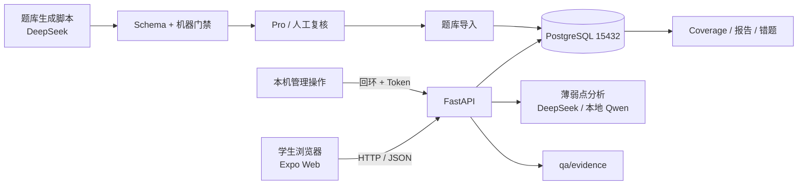
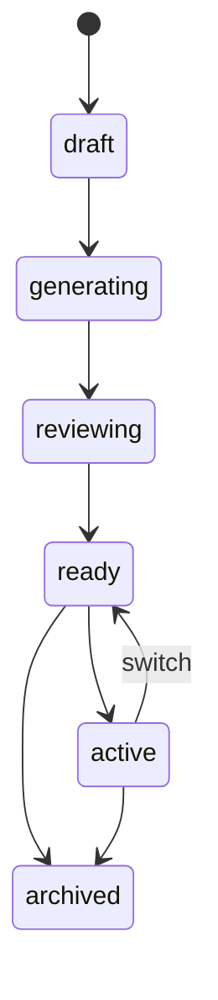
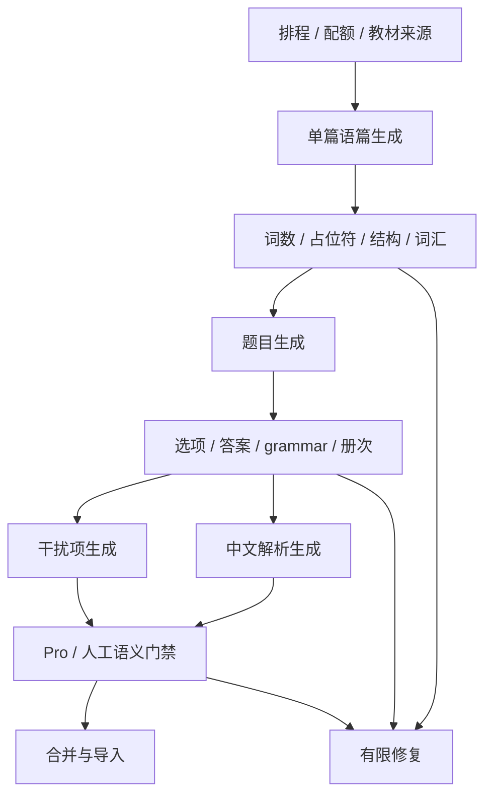

# 高二英语智能练习系统架构说明

状态日期：2026-11-09  
当前 active Bank：`20261109_500`（72 篇 / 500 题）  
需求版本：`contracts/VERSION = V11.5`

## 1. 系统定位

系统面向高二学生提供一套可追踪的英语练习闭环，同时为运营者提供题库生成、导入、校验、切换和覆盖审计能力。

核心非目标：

- 不做多租户学校管理。
- 不做教师端和家长端。
- 不把模型输出直接视为已审核题目。
- 不在交卷前向客户端发送答案或解析。

## 2. 逻辑架构



实际核心运行链路只依赖 FastAPI 和 PostgreSQL。Redis 和 Docker Compose 属于目标运行方案或后续扩展，不应在当前未验证时声称已进入关键路径。

## 3. 前端

技术：React Native + Expo SDK 58 + Expo Web。

页面：

- `/`：首页、当前题库、覆盖统计、开始练习、错题本和历史报告入口。
- `/practice`：逐题作答、自动下一题、交卷/退出确认、交卷后原题回顾。
- `/report`：分数、正确率、薄弱点分析、逐题解析、查看原题。
- `/history`：历史报告列表、打开和删除。
- `/mistakes`：当前/历史题库错题分组。
- `/mistake-review`：按篇错题重做。

设计约束：

- 所有颜色、字号、间距和桌面尺寸来自 `contracts/design-tokens.json`。
- 强制浅色主题，白底黑字。
- 桌面内容宽度和正文宽度由 tokens 控制；练习文章正文当前最大宽度为 836。
- `device_student_id` 在 Web 端存 localStorage，属于已登记的安全降级。

API 契约：

- `contracts/openapi.yaml` 是接口契约。
- `apps/mobile/src/api/generated.d.ts` 由 OpenAPI 生成。
- `scripts/check-api-contract.ps1` 对照前端实际调用和 OpenAPI 路径。

## 4. 后端

核心模块：

| 模块 | 职责 |
|---|---|
| `backend/app/main.py` | FastAPI 路由、请求模型、错误映射、安全中间件 |
| `backend/app/pg_store.py` | PostgreSQL 仓储、会话、报告、错题、切换、审计 |
| `backend/app/composer.py` | 纯组卷规则 |
| `backend/app/bank_transfer.py` | 题库导入、导出、删除预览与执行 |
| `backend/app/analysis.py` | 薄弱点模型提示、输出清洗、降级和成本记录 |
| `backend/app/deepseek_generation.py` | JSON 客户端、重试、熔断、预算账本 |
| `backend/app/m2_deepseek_pipeline.py` | 分阶段题库生成、Schema 校验和修复循环 |
| `backend/app/question_validation.py` | 题目结构、grammar 和册次兼容校验 |

## 5. 数据模型

主要实体：

```text
question_banks
  ├─ passages
  ├─ questions
  ├─ generation_jobs
  ├─ coverage_snapshots
  └─ bank_audit_logs

practice_sessions
  ├─ session_items
  ├─ saved_answers
  ├─ question_attempts
  └─ practice_reports

mistake_items
error_tags
report_deletions
knowledge_mastery
```

关键约束：

- `questions` 使用 `(bank_id, id)` 复合关系，禁止跨 Bank 关联。
- 同一时刻最多一个 active Bank。
- 会话创建时快照 Bank 身份。
- 交卷保存完整题目快照和解析。
- 报告删除使用软删标记；错题和掌握状态按业务语义保留。

## 6. Bank 生命周期



导入后的普通 `bank-v1` 题库按当前产品行为可直接成为 active；全量生成题库仍应经过生成、审核和 Coverage 检查。

## 7. 练习与组卷

每套练习：

- 1 篇完形填空。
- 1 篇语法填空。
- 1 篇阅读理解或七选五。

当前选题规则只有两条：

1. 计算三篇语篇在当前学生、当前 Bank 的覆盖次数总和，越小越优先。
2. 覆盖次数总和并列时，优先 3 个不同话题。

覆盖次数按已交卷或已过期会话去重，不按篇内题数累计。错题权重、历史权重、册次、难度、grammar tag 重复、知识点重复、错题池占比和并发同篇冲突均不参与当前选题。

## 8. 答案安全与交卷

- 会话接口在交卷前不得返回 `answer`、`explanation`。
- 服务端 deadline 是计时权威。
- 交卷使用幂等键；同一键重复提交返回同一报告。
- 报告生成后才自动跳转报告页。
- 已交卷原题回顾接口只允许读取已提交/过期会话，并返回解析。

## 9. AI 内容生产架构



必须保留的边界：

- 机器校验证明“结构没有已知错误”，不能证明“内容一定正确”。
- 语义唯一性、语篇连贯和解释真实性必须由 Pro 或人工复核。
- 模型自报 `word_count`、难度和 Flesch 等字段不能作为唯一事实来源。
- 失败请求、原始响应、token、成本和 finish reason 应留档。

## 10. 运行与发布

推荐启动顺序：

1. PostgreSQL 16，固定 15432 和 `english_practice`。
2. FastAPI：`0.0.0.0:8000`。
3. Expo Web：`localhost:8081`。
4. 健康检查：`/healthz`、`/api/v1/healthz`。
5. 检查 active Bank 和题量。
6. 浏览器完成一次练习、交卷、报告、原题回顾。

发布门禁：

```powershell
.\scripts\check-m0.ps1
.\scripts\check-api-contract.ps1
cd apps\mobile
C:\Users\Administrator\node24\npm.cmd run typecheck
```

数据库、报告和 UI 行为仍需对应 pytest、SQL 或浏览器证据。

## 11. 已知限制

- 当前文档中仍有历史里程碑和旧题库状态，阅读时应先确认 active Bank。
- 全量 pytest 曾受固定名称测试 Bank 残留影响，重复运行需要更严格的测试数据隔离。
- 当前 active Bank 的部分内容质量仍需按 500 题标准持续抽检。
- Redis/Compose 的完整生产化路径未作为当前核心链路验证。
- Web 端 localStorage 不是安全存储。
- 题库导入后激活策略需要结合生产权限模型继续收紧。

## 12. 可扩展点

- 将生成、审核、导入做成可视化后台。
- 为题库质量建立长期趋势仪表盘。
- 对薄弱点分析引入人工抽检集和离线评测。
- 将题库和生成证据做成可版本化的 release artifact。
- 把低覆盖选题扩展为更完整的掌握度和时间衰减策略，但必须先有足够题库和离线回放证明。
